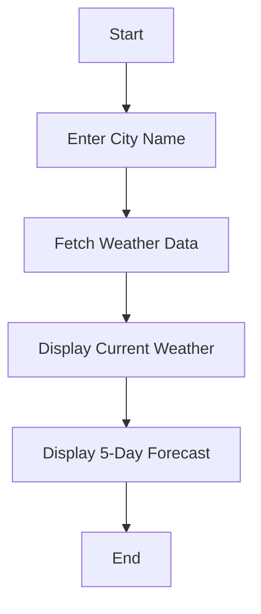

## 1. Product Overview
A modern, highly polished Weather App designed with a dark theme and green accents. It provides real-time weather information with a focus on exceptional UI/UX and smooth interactions.

- **Main Purpose**: Provide accurate weather data in a visually stunning interface.
- **Target Users**: Users who appreciate high-quality design and need quick weather updates.
- **Market Value**: Stands out from generic weather apps with a unique, professional aesthetic.

## 2. Core Features

### 2.1 User Roles
| Role | Registration Method | Core Permissions |
|------|---------------------|------------------|
| Normal User | Anonymous | Search for cities, view current weather, and see forecasts. |

### 2.2 Feature Module
1. **Home page**: Hero section with search, current weather display, and 5-day forecast cards.
2. **Settings**: (Optional) Unit toggle (Celsius/Fahrenheit).

### 2.3 Page Details
| Page Name | Module Name | Feature description |
|-----------|-------------|---------------------|
| Home page | Hero Section | Centered search bar with auto-focus and city suggestions. |
| Home page | Weather Display | Main card showing temperature, condition, and location. |
| Home page | Forecast Grid | Horizontal scrollable grid of daily forecast cards with icons. |
| Home page | Custom Cursor | A dynamic, glowing cursor that reacts to interactive elements. |

## 3. Core Process
1. User enters the app and is greeted by the polished dark interface.
2. User types a city name in the search bar.
3. App fetches weather data from a weather API.
4. App displays current weather and forecast with smooth animations.

## 4. User Interface Design

### 4.1 Design Style
- **Primary Color**: #000000 (Black)
- **Secondary Color**: #4ade80 (Green-400)
- **Accent Color**: #1a1a1a (Dark Gray)
- **Button Style**: Rounded-lg, green background, black text, smooth hover glow.
- **Font**: "Inter" for body, "Space Grotesk" for display/headings.
- **Layout Style**: Centered card-based layout with generous negative space.
- **Icon Style**: Lucide-react icons in green/white.

### 4.2 Page Design Overview
| Page Name | Module Name | UI Elements |
|-----------|-------------|-------------|
| Home page | Hero Section | Large typography, glassmorphism search bar, custom cursor trail. |
| Home page | Weather Card | Gradient background, animated weather icons, crisp typography. |

### 4.3 Responsiveness
- **Desktop-first**: Optimized for large screens with wide layouts.
- **Mobile-adaptive**: Stacked layout for smaller screens, touch-friendly buttons.
- **Touch optimization**: Large hit areas for search and forecast cards.
