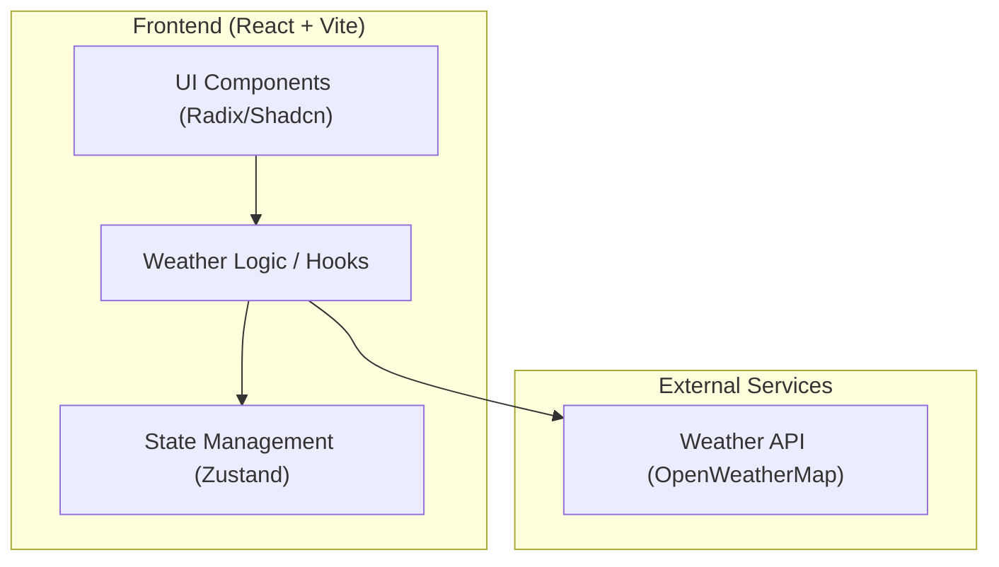
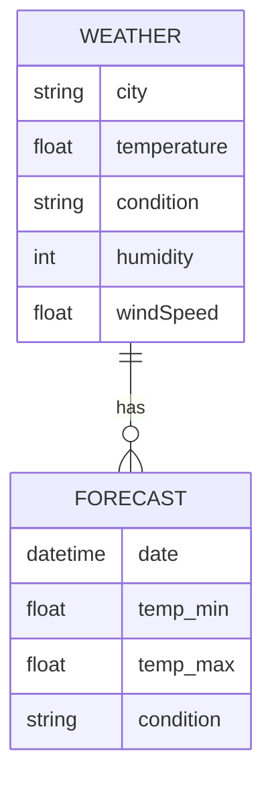

## 1. Architecture Design

## 2. Technology Description
- **Frontend**: React@18 + tailwindcss@3 + vite
- **Initialization Tool**: vite-init (react-ts template)
- **State Management**: Zustand
- **Icons**: Lucide-react
- **Animations**: Framer Motion
- **Styling**: Tailwind CSS with custom configuration for the black/green theme.

## 3. Route Definitions
| Route | Purpose |
|-------|---------|
| / | Main Home page with all weather features |

## 4. API Definitions
- **Weather API**: `https://api.openweathermap.org/data/2.5/weather?q={city}&appid={apiKey}&units=metric`
- **Forecast API**: `https://api.openweathermap.org/data/2.5/forecast?q={city}&appid={apiKey}&units=metric`

## 5. Data Model
### 5.1 Data Model Definition

